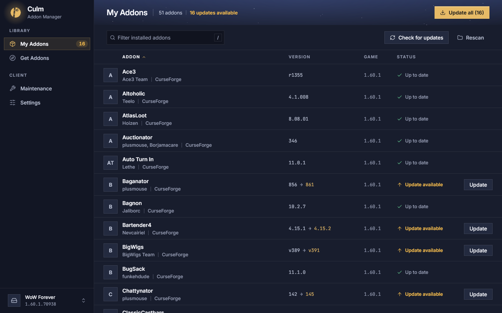
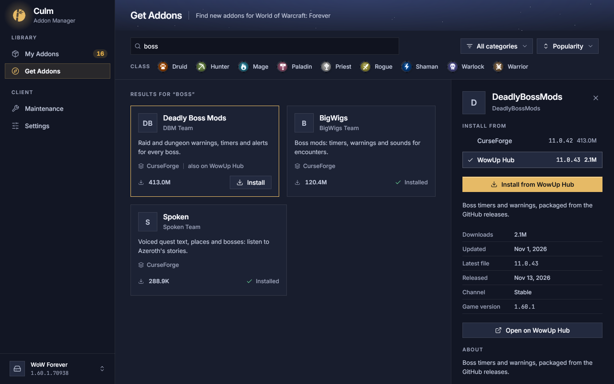
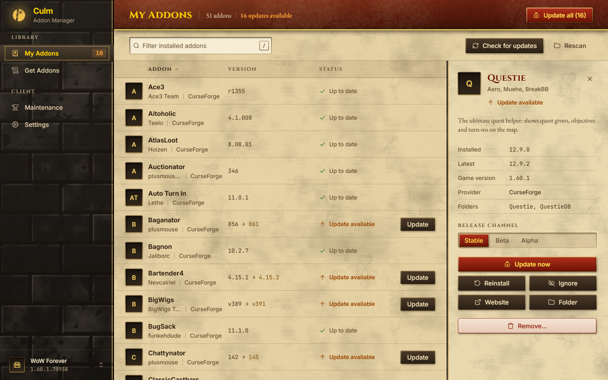
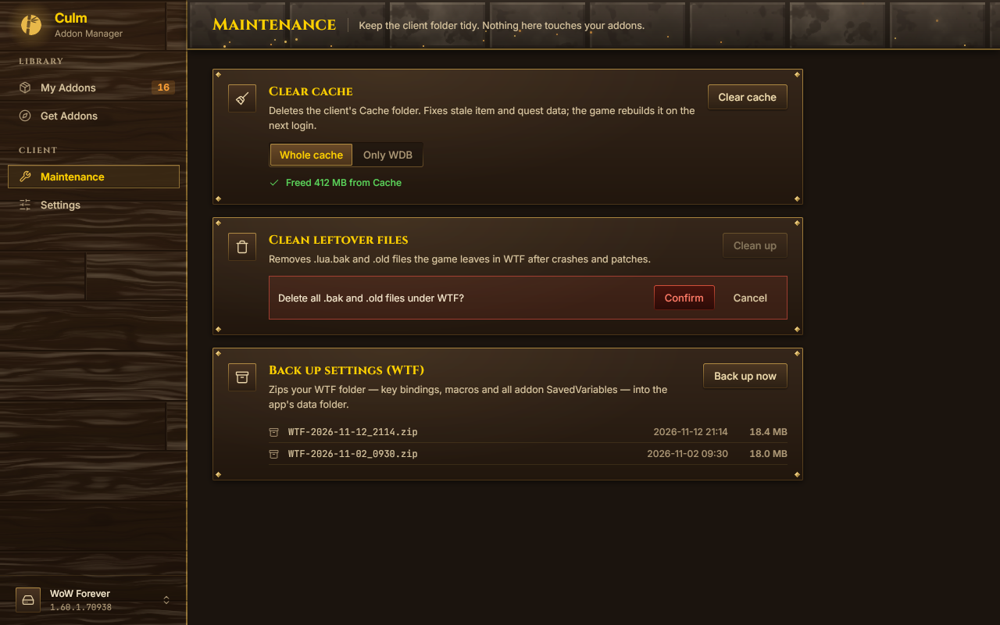
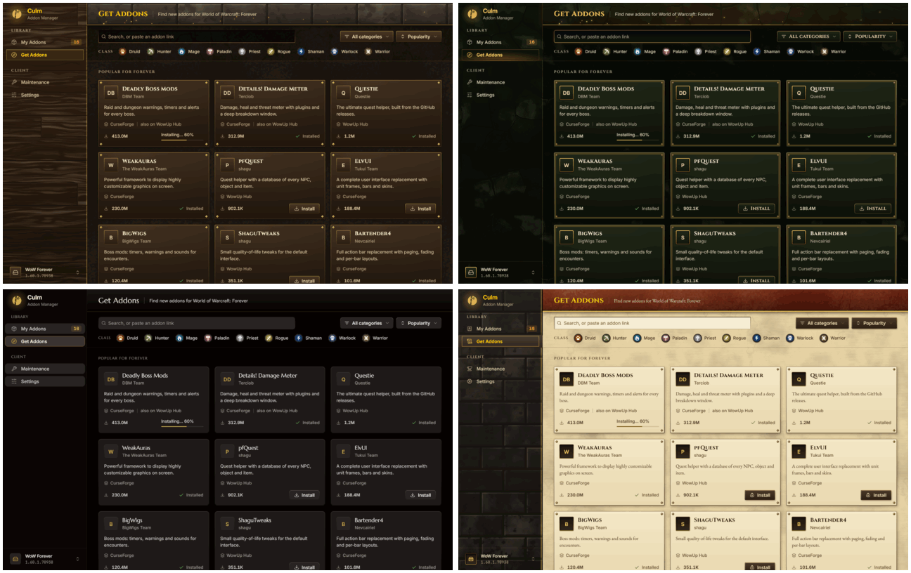

# Culm

An addon manager for **World of Warcraft: Forever** on Linux, Windows and macOS, written in Rust on the
[Rune](https://github.com/anomalyco/rune) GUI framework.

**Status:** beta (0.x): usable, but expect rough edges and changes. Linux first; Windows and macOS are new, built and
tested by CI but barely tried by hand yet (feedback welcome). Detects Forever clients in Wine/Proton/Faugus/Lutris/Bottles
prefixes and the usual Windows and macOS install folders, imports
existing addon records, scans and groups `Interface/AddOns`, updates/installs/removes addons from CurseForge,
WowUp Hub, GitHub (WowInterface is implemented but disabled: no game-version info for Forever), and has client maintenance (cache, WTF leftovers, WTF backups). What exactly works and
how it is tested: [docs/FEATURES.md](docs/FEATURES.md).



| Get Addons: one search over CurseForge, WowUp Hub and GitHub links | Addon detail in the Grimoire theme |
|---|---|
|  |  |
| **Client maintenance** (Hearthwood theme) | **Themes:** Hearthwood, Emberglow, Ledger, Grimoire |
|  |  |

## Install

Everything is on the [latest release](https://github.com/gengurke/Culm/releases/latest) page. What changed in each
version: [CHANGELOG.md](CHANGELOG.md).

### Linux

1. Download `Culm-<version>-x86_64.AppImage`.
2. Make it executable and start it: `chmod +x Culm-*.AppImage && ./Culm-*.AppImage`
   (or right-click → Properties → "Allow executing as program").

Recommended: open it with [Gear Lever](https://flathub.org/apps/it.mijorus.gearlever). It adds Culm to your app
menu and updates it with one click; AppImageUpdate and AppImageLauncher work too (the AppImage carries zsync
update information). The AppImage also updates itself from inside the app.

### Windows 10/11

Run `Culm-<version>-windows-x64-setup.exe`. It installs Culm for your user only (no admin rights), adds it to the
Start menu (a desktop icon if you tick it) and to "Installed apps" for uninstalling.

Culm isn't code-signed yet, so the first start shows "Windows protected your PC": click **More info → Run anyway**.

### macOS 13 or newer (Apple Silicon and Intel)

Open `Culm-<version>-macos.dmg` and drag Culm onto Applications.

Culm isn't notarized by Apple yet, so the first start is blocked ("Apple could not verify…"): click **Done**, open
**System Settings → Privacy & Security**, scroll down to the message about Culm and click **Open Anyway**. Each
newly downloaded version may ask for this once again.

On Windows and macOS Culm checks for a new version when it starts; its "Update to x.y.z" button opens the release
page, where you download it the same way (the installer and the .dmg replace the old version).

## Build and run

Install [Rust](https://rustup.rs) (the repo's `rust-toolchain.toml` picks the version) and the build dependencies:

| OS | Build dependencies |
|---|---|
| Fedora | `sudo dnf install libxkbcommon-devel wayland-devel` |
| Debian, Ubuntu | `sudo apt install libxkbcommon-dev libwayland-dev` |
| Windows | Visual Studio Build Tools with "Desktop development with C++" (rustup offers to install them) |
| macOS | Xcode Command Line Tools: `xcode-select --install` |

```sh
cargo build --release
target/release/culm      # target\release\culm.exe on Windows
```

The first build takes a few minutes (Rune is big).

A desktop entry is in `packaging/dev.culm.app.desktop`: put the binary on your `PATH` (or set `Exec` to it) and copy it to
`~/.local/share/applications/` if you want a launcher; copy `packaging/culm.svg` to
`~/.local/share/icons/hicolor/scalable/apps/culm.svg` for its icon.

## CurseForge API key

CurseForge (search, update checks, fingerprint matching) needs your own free API key:

1. Sign in at <https://console.curseforge.com> and create an API key (section "API keys").
2. In the app: **Settings → CurseForge → API key**, paste it, **Save**. It is stored only on this computer.

Without a key the app still scans, imports existing records, updates GitHub addons and offers updates
the import already knew about; CurseForge addons show "Not checked".

## Where data lives

| What | Linux | Windows | macOS |
|---|---|---|---|
| Data: installations, addon lists, class icons, WTF backups | `~/.local/share/dev.culm.app/` | `%APPDATA%\dev.culm.app\` | `~/Library/Application Support/dev.culm.app/` |
| Settings (API key, theme, defaults) | `~/.config/dev.culm.app/` | `%APPDATA%\dev.culm.app\` | `~/Library/Application Support/dev.culm.app/` |
| Thumbnail cache (safe to delete) | `~/.cache/dev.culm.app/` | `%LOCALAPPDATA%\dev.culm.app\Cache\` | `~/Library/Caches/dev.culm.app/` |
| Log: errors and crashes (`culm.log`, `culm.old.log`) | `~/.local/state/dev.culm.app/logs/` | `%LOCALAPPDATA%\dev.culm.app\Logs\` | `~/Library/Logs/dev.culm.app/` |

In the data folder: `installations.json`, `addons/<id>.json` (one list per installation), `class-icons/` and
`wtf-backups/<installation id>/`.

`RUNE_DIRS_ROOT=/some/dir` moves all of them (handy for a test run). Imported files are only read, never written.

No telemetry. What Culm sends to which service: [docs/PRIVACY.md](docs/PRIVACY.md).

## Tests

```sh
cargo test                     # headless, no network, never touches your real WoW folder
cargo clippy --all-targets
```

- `crates/core/tests/*.rs`: feature tests of the core against temp WoW trees and a local fake HTTP server.
- `crates/app/tests/e2e_*.rs`: the real UI driven headlessly (Rune `Runtime`) over the real core and the same fakes.
- `crates/app/tests/ui_shell.rs`: UI-only checks over the mock backend.

Test names carry the feature id from `docs/FEATURES.md` (`f3_2_...`). How to contribute: [CONTRIBUTING.md](CONTRIBUTING.md).

## Inspiration and thanks

Culm builds on the work of others:

- **[WowUp](https://github.com/WowUp/WowUp)** (GPL-3.0), the addon manager many Forever players already use, and the
  model for Culm's My Addons / Get Addons split. Culm's folder fingerprints follow WowUp's scanners and are checked
  against its test fixture. Culm can import WowUp's addon records (Settings), and it searches the
  [WowUp Hub](https://wowup.io/addons), WowUp's public index of GitHub-hosted addons.
- **[Rune](https://github.com/anomalyco/rune)**, the GUI framework Culm is drawn with.
- **[Polestar](https://www.polestar.com)**'s calm, minimal design language inspired the Moonlit theme.

Culm is an independent project, not affiliated with or endorsed by WowUp or Polestar.

## License

Copyright (C) 2026 the Culm contributors.

This program is free software: you can redistribute it and/or modify it under the terms of the GNU General Public
License as published by the Free Software Foundation, either version 3 of the License, or (at your option) any later
version. It is distributed WITHOUT ANY WARRANTY; see [LICENSE](LICENSE) for the full text.

Fonts: Inter, JetBrains Mono, Cinzel, Marcellus and EB Garamond are bundled under the SIL Open Font License 1.1; see
`crates/app/assets/fonts` (each family's `OFL.txt` beside it).
All third-party licences (Rust crates and fonts): [THIRD-PARTY-LICENSES.md](THIRD-PARTY-LICENSES.md), also under
Settings → About → Licences.

World of Warcraft is a trademark of Blizzard Entertainment. Culm is a community project, not affiliated with or
endorsed by Blizzard.
